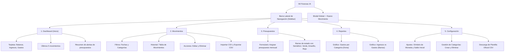

# Fase 2: Experiencia de Usuario (UX/UI y Arquitectura de Información) — Mi Finanzas IA

---

## 1. Principios de Diseño y Objetivos de Experiencia de Usuario

Para garantizar que **Mi Finanzas IA** sea fácil de usar para cualquier persona sin conocimientos técnicos ni contables, el diseño de interacción se fundamenta en cuatro pilares:

1. **Claridad Inmediata:** El usuario debe entender su estado financiero en menos de 5 segundos tras ingresar a la aplicación.
2. **Registro sin Fricción:** Registrar una transacción debe tomar menos de 15 segundos mediante un modal accesible desde cualquier pantalla.
3. **Prevención y Manejo Amigable de Errores:** Mensajes claros en lenguaje cotidiano, impidiendo fallos silenciosos y guiando al usuario ante omisiones.
4. **Retroalimentación Visual Inmediata:** Uso intuitivo del color (verde para ingresos o presupuestos saludables, amarillo para advertencias preventivas y rojo para gastos, saldo negativo o presupuestos excedidos).

---

## 2. Arquitectura de Información

La aplicación se estructura en **5 secciones principales** accesibles directamente mediante una barra lateral izquierda fija (Sidebar), complementada por un modal global para registro rápido:



---

## 3. Navegación y Distribución General de la Interfaz

### 3.1. Estructura de Pantalla (Layout Base)
- **Barra Lateral Izquierda (Sidebar Fijo):**
  - **Cabecera:** Logotipo y nombre "Mi Finanzas IA" (hacer clic siempre redirige al Dashboard).
  - **Acción Principal Destacada:** Botón prominente `+ Nuevo Movimiento`.
  - **Enlaces de Navegación:**
    - 📊 Dashboard
    - 💳 Movimientos
    - 🎯 Presupuestos
    - 📈 Reportes
    - ⚙️ Configuración
- **Área Principal de Contenido (Main Content):**
  - Encabezado con título de la sección activa.
  - Contenido dinámico según la sección seleccionada.

---

## 4. Wireframes de Pantallas Principales

### 4.1. Wireframe: Dashboard (Inicio)
```text
+-----------------------------------------------------------------------------------+
| Mi Finanzas IA  |  DASHBOARD                                                     |
|                 |  Periodo actual: Noviembre 2026                                 |
| [+ Nuevo Mov.]  +-----------------------------------------------------------------+
|                 |  [ BALANCE GENERAL ]   [ TOTAL INGRESOS ]   [ TOTAL GASTOS ]   |
| * Dashboard     |     $ 1,450.00             $ 2,200.00           $ 750.00       |
| * Movimientos   |    (Verde si >= 0)           (Verde)             (Rojo)        |
| * Presupuestos  +-----------------------------------------------------------------+
| * Reportes      |  ESTADO DE PRESUPUESTOS (Mes Actual)                            |
| * Configuración |  - Alimentación: [========--------] 65% ($260/$400) [🟢 Normal]  |
|                 |  - Ocio:         [================] 105% ($210/$200) [🔴 Excedido]|
|                 +-----------------------------------------------------------------+
|                 |  ÚLTIMOS MOVIMIENTOS                             [Ver todos ->] |
|                 |  12/11  Supermercado        Alimentación   -$ 45.00 (Gasto)     |
|                 |  10/11  Nómina Quincenal    Salario        +$1,100.00 (Ingreso) |
|                 |  08/11  Gasolina            Transporte     -$ 30.00 (Gasto)     |
+-----------------------------------------------------------------------------------+
```

---

### 4.2. Wireframe: Ventana Modal `+ Nuevo Movimiento`
Se superpone a la pantalla actual con un fondo atenuado (backdrop) para registrar ágilmente una transacción.
```text
+------------------------------------------------------------+
|  Registrar Nuevo Movimiento                           [ X ]|
+------------------------------------------------------------+
|  Tipo de Movimiento:                                       |
|  ( ) Ingreso               (*) Gasto                       |
|                                                            |
|  Importe:*                                                 |
|  [ $  ] [ 45.00                                          ] |
|                                                            |
|  Fecha:*                                                   |
|  [ 2026-11-12                                            ] |
|                                                            |
|  Categoría:*                                               |
|  [ Seleccionar categoría...                            v ] |
|                                                            |
|  Descripción (Opcional):                                   |
|  [ Ej. Supermercado semanal                              ] |
+------------------------------------------------------------+
|                     [ Cancelar ]    [ Guardar Movimiento ] |
+------------------------------------------------------------+
```

---

### 4.3. Wireframe: Pantalla de Movimientos
```text
+-----------------------------------------------------------------------------------+
| Mi Finanzas IA  |  MOVIMIENTOS                                                    |
|                 +-----------------------------------------------------------------+
| [+ Nuevo Mov.]  |  FILTROS:                                                       |
|                 |  Fecha: [ Este Mes          v ]  Categoría: [ Todas        v ]  |
| * Dashboard     |                                                                 |
| * Movimientos   |  HERRAMIENTAS:                                                  |
| * Presupuestos  |  [ Subir / Importar CSV ]            [ Descargar / Exportar CSV]|
| * Reportes      +-----------------------------------------------------------------+
| * Configuración |  Fecha      Tipo     Categoría    Descripción  Importe  Acciones|
|                 |  -------------------------------------------------------------- |
|                 |  12/11/26   Gasto    Alimentación Supermercado -$45.00  [✏️] [🗑️] |
|                 |  10/11/26   Ingreso  Salario      Nómina      +$1100.00 [✏️] [🗑️] |
|                 |  08/11/26   Gasto    Transporte   Gasolina     -$30.00  [✏️] [🗑️] |
|                 +-----------------------------------------------------------------+
|                 |  Total registros: 3             Total filtrado: +$1,025.00      |
+-----------------------------------------------------------------------------------+
```

---

### 4.4. Wireframe: Pantalla de Presupuestos
```text
+-----------------------------------------------------------------------------------+
| Mi Finanzas IA  |  PRESUPUESTOS MENSUALES                                         |
|                 +-----------------------------------------------------------------+
| [+ Nuevo Mov.]  |  ASIGNAR PRESUPUESTO (Mes: Noviembre 2026)                      |
|                 |  Categoría: [ Alimentación   v ]  Límite: [ $ 400.00 ] [Guardar]|
| * Dashboard     +-----------------------------------------------------------------+
| * Movimientos   |  CONTROL DE CONSUMO                                             |
| * Presupuestos  |                                                                 |
| * Reportes      |  🟢 Alimentación                                                |
| * Configuración |  Gastado: $260.00 / $400.00 (65.0%)                             |
|                 |  [======================------------]  Quedan: $140.00          |
|                 |                                                                 |
|                 |  🟡 Servicios Públicos                                          |
|                 |  Gastado: $170.00 / $200.00 (85.0%)   ⚠️ Alerta Preventiva      |
|                 |  [============================------]  Quedan: $30.00           |
|                 |                                                                 |
|                 |  🔴 Ocio y Entretenimiento                                      |
|                 |  Gastado: $210.00 / $200.00 (105.0%)  ⛔ Límite Superado        |
|                 |  [==================================]  Excedido en: $10.00      |
+-----------------------------------------------------------------------------------+
```

---

### 4.5. Wireframe: Pantalla de Reportes
```text
+-----------------------------------------------------------------------------------+
| Mi Finanzas IA  |  REPORTES Y GRÁFICOS                                            |
|                 +-----------------------------------------------------------------+
| [+ Nuevo Mov.]  |  Periodo: [ Mes Actual (Noviembre 2026)                      v ]|
|                 +--------------------------------+--------------------------------+
| * Dashboard     | DISTRIBUCIÓN DE GASTOS         | INGRESOS VS GASTOS             |
| * Movimientos   | (Gráfico de Dona por Categoría)| (Comparativa de Barras)        |
| * Presupuestos  |                                |                                |
| * Reportes      |          (  Alim: 45% )        |      $2200                     |
| * Configuración |          (  Ocio: 30% )        |      [==]                      |
|                 |          (  Trans: 25%)        |      [==]             $750     |
|                 |                                |      [==]             [==]     |
|                 |                                |   Ingresos           Gastos    |
+-----------------------------------------------------------------------------------+
```

---

### 4.6. Wireframe: Pantalla de Configuración
```text
+-----------------------------------------------------------------------------------+
| Mi Finanzas IA  |  CONFIGURACIÓN GENERAL                                          |
|                 +-----------------------------------------------------------------+
| [+ Nuevo Mov.]  |  PREFERENCIAS BÁSICAS                                           |
|                 |  Símbolo de Moneda: [ $   ]                                     |
| * Dashboard     |  Saldo Inicial:     [ $ 500.00 ]                     [ Guardar ]|
| * Movimientos   +-----------------------------------------------------------------+
| * Presupuestos  |  GESTIÓN DE CATEGORÍAS                                          |
| * Reportes      |  Nueva categoría: [ Nombre...         ]          [ + Agregar ]  |
| * Configuración |  -------------------------------------------------------------- |
|                 |  • Alimentación                     (Predeterminada)            |
|                 |  • Vivienda                         (Predeterminada)            |
|                 |  • Transporte                       (Predeterminada)            |
|                 |  • Cursos y Capacitación            (Personalizada)  [ Eliminar]|
|                 +-----------------------------------------------------------------+
|                 |  RESPALDO Y PLANTILLA                                           |
|                 |  Formato para importación masiva:                               |
|                 |  [ 📄 Descargar Plantilla Oficial CSV ]                         |
+-----------------------------------------------------------------------------------+
```

---

## 5. Flujos de Usuario Principales

### Flujo 1: Configurar Moneda y Saldo Inicial
1. El usuario accede a la sección **Configuración** desde la barra lateral.
2. Ingresa su símbolo monetario deseado (ej. `$`, `€`, `S/.`, `MXN`).
3. Ingresa su saldo inicial disponible y presiona **Guardar**.
4. El sistema actualiza de inmediato el balance en el Dashboard.

### Flujo 2: Registrar un Ingreso o Gasto (Modal Rápido)
1. El usuario hace clic en el botón destacado `+ Nuevo Movimiento` desde cualquier pantalla.
2. Se abre el diálogo modal centrado.
3. Elige el tipo (Ingreso o Gasto).
4. Escribe el importe ($> 0$), confirma la fecha, selecciona la categoría de la lista y añade una descripción opcional.
5. Presiona **Guardar Movimiento**.
6. El modal se cierra, se emite una notificación de éxito y el balance y tablas se actualizan al instante.

### Flujo 3: Consultar y Filtrar Movimientos
1. El usuario hace clic en **Movimientos** en la barra lateral.
2. Utiliza el selector de fecha (ej. "Este Mes", "Rango específico") o el filtro de categoría.
3. La tabla actualiza de inmediato las transacciones coincidentes y recalcula el total filtrado.

### Flujo 4: Editar o Eliminar un Movimiento
- **Edición:**
  1. El usuario localiza la fila en la tabla de Movimientos y pulsa el icono de lápiz (Editar).
  2. Se abre el modal precargado con los datos del movimiento.
  3. Modifica los campos requeridos y pulsa **Guardar Cambios**.
  4. Los datos y balances se recalculan inmediatamente.
- **Eliminación:**
  1. El usuario pulsa el icono de papelera (Eliminar).
  2. Aparece un mensaje de confirmación: *"¿Estás seguro de eliminar este movimiento? Esta acción no se puede deshacer"*.
  3. Al confirmar, el movimiento se borra y el balance se reajusta.

### Flujo 5: Crear y Consultar Presupuestos
1. El usuario accede a la sección **Presupuestos**.
2. Selecciona una categoría, escribe el importe límite mensual y pulsa **Guardar**.
3. Se crea una tarjeta o barra de progreso para esa categoría.
4. Conforme registre gastos en dicha categoría, la barra avanza y cambia automáticamente de color: Verde (< 80%), Amarillo (80% a 99.9%) o Rojo (≥ 100%).

### Flujo 6: Analizar Finanzas mediante Gráficos
1. El usuario navega a **Reportes**.
2. Elige el período a examinar.
3. Observa la gráfica circular para identificar en qué categoría gasta más dinero y la gráfica comparativa para evaluar su capacidad de ahorro (ingresos vs gastos).

### Flujo 7: Importar y Exportar Movimientos CSV
- **Exportación:**
  1. Desde la pantalla **Movimientos**, el usuario presiona **Descargar / Exportar CSV**.
  2. El navegador descarga automáticamente el archivo con todas las transacciones actuales.
- **Importación:**
  1. En **Movimientos**, el usuario presiona **Subir / Importar CSV**.
  2. Selecciona un archivo `.csv` estructurado con la plantilla oficial.
  3. El sistema valida el archivo. Si es correcto, añade los movimientos y notifica al usuario cuántos registros se cargaron.

### Flujo 8: Administrar Categorías
1. El usuario entra en **Configuración** > sección **Gestión de Categorías**.
2. Para crear: escribe el nombre y presiona `+ Agregar`.
3. Para eliminar: pulsa `Eliminar` en la categoría correspondiente. Si contenía transacciones, el sistema muestra el aviso de reasignación a `"Otros"`.

---

## 6. Casos Excepcionales y Prevención de Errores

| Caso Excepcional | Comportamiento del Sistema y Solución UX |
| :--- | :--- |
| **Formulario incompleto o con importe $\le 0$** | El botón de guardar valida los campos. Se destaca el campo infractor con borde rojo y un mensaje claro: *"Ingresa un importe mayor a cero"* o *"Selecciona una categoría"*. No se cierra el modal ni se guardan datos corruptos. |
| **Eliminación de categoría con movimientos asociados** | Se muestra un diálogo de advertencia: *"Esta categoría tiene movimientos registrados. Al eliminarla, dichos movimientos se conservarán pero pasarán automáticamente a la categoría 'Otros'. ¿Deseas continuar?"*. |
| **Archivo CSV con formato erróneo o columnas faltantes** | El sistema detiene la importación, mantiene los datos existentes intactos y muestra un mensaje amigable: *"El archivo no cumple con la estructura requerida. Asegúrate de usar la plantilla oficial (Fecha, Tipo, Categoría, Descripción, Importe)"*. |
| **Balance general negativo** | El balance general muestra el número con signo negativo y en tipografía/fondo de color rojo de advertencia, alertando al usuario de un déficit sin bloquear ninguna acción. |
| **Presupuesto mensual superado ($\ge 100\%$)** | La barra de progreso de la categoría se tiñe de rojo intenso, mostrando una etiqueta de advertencia (*"Límite superado en $X"*) tanto en la sección de Presupuestos como en el resumen del Dashboard. |

---

## 7. Estado de la Fase 2
- **Estado:** Aprobada formalmente.
