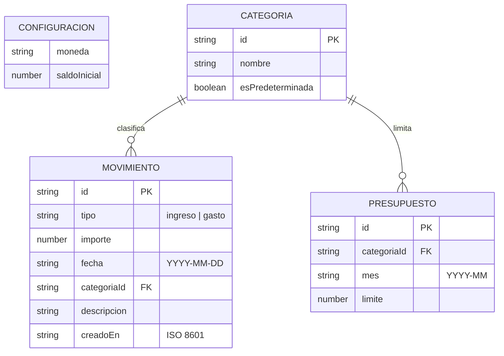
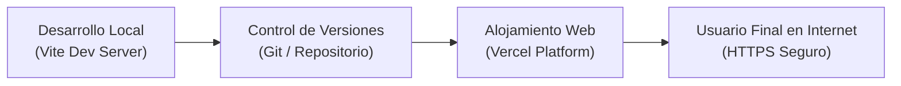

# Fase 4: Datos y Entorno Técnico — Mi Finanzas IA

---

## 1. Modelo de Datos

Para que **Mi Finanzas IA** opere de forma rápida y sencilla en el navegador, los datos se estructuran en **4 entidades principales** almacenadas en formato JSON:

---

### 1.1. Detalle de Entidades y Atributos

#### A. Entidad `Movimiento`
Representa cada ingreso o gasto registrado.
- `id` (Texto / UUID): Identificador único único e irrepetible (ej. `"mov_1731513600_abc12"`).
- `tipo` (Texto): `"ingreso"` o `"gasto"`.
- `importe` (Número): Valor decimal estrictamente mayor a 0 (ej. `45.50`).
- `fecha` (Texto): Fecha del movimiento en formato ISO `YYYY-MM-DD` (ej. `"2026-11-13"`).
- `categoriaId` (Texto): Identificador de la categoría asociada.
- `descripcion` (Texto opcional): Detalle o nota breve del movimiento (ej. `"Supermercado semanal"`).
- `creadoEn` (Texto): Marca de tiempo de registro en formato ISO (ej. `"2026-11-13T10:30:00Z"`).

#### B. Entidad `Categoria`
Representa las etiquetas de clasificación de movimientos.
- `id` (Texto): Identificador único o clave simplificada (ej. `"cat_alimentacion"`, `"cat_salario"`).
- `nombre` (Texto): Nombre visible de la categoría (ej. `"Alimentación"`, `"Salario"`).
- `esPredeterminada` (Booleano): `true` para categorías precargadas por el sistema; `false` para las creadas por el usuario.

#### C. Entidad `Presupuesto`
Define el límite mensual de gasto fijado por el usuario para una categoría.
- `id` (Texto / UUID): Identificador único (ej. `"pres_2026_11_cat_alimentacion"`).
- `categoriaId` (Texto): Identificador de la categoría presupuestada.
- `mes` (Texto): Mes y año objetivo en formato `YYYY-MM` (ej. `"2026-11"`).
- `limite` (Número): Monto máximo mensual autorizado ($> 0$).

#### D. Entidad `Configuracion`
Almacena las preferencias del usuario.
- `moneda` (Texto): Símbolo o código de divisa seleccionado (ej. `"$"`).
- `saldoInicial` (Número): Monto inicial declarado de partida (ej. `500.00`).

---

## 2. Estrategia de Almacenamiento Local (`LocalStorage`)

Toda la información se persistirá de forma directa en el almacenamiento nativo del navegador del usuario utilizando claves aisladas:

| Clave en LocalStorage | Tipo de Contenido | Descripción |
| :--- | :--- | :--- |
| `mi_finanzas_movimientos` | Arreglo JSON (`Array<Movimiento>`) | Lista completa de ingresos y gastos. |
| `mi_finanzas_categorias` | Arreglo JSON (`Array<Categoria>`) | Lista de categorías predeterminadas y creadas por el usuario. |
| `mi_finanzas_presupuestos` | Arreglo JSON (`Array<Presupuesto>`) | Límite de gasto mensual fijado por categoría. |
| `mi_finanzas_configuracion` | Objeto JSON (`Configuracion`) | Símbolo de moneda y saldo inicial. |

### Justificación de la Elección:
- **Simplicidad:** No requiere levantar servidores de bases de datos (como MySQL o PostgreSQL) ni configurar contraseñas.
- **Capacidad holgada:** `LocalStorage` ofrece hasta 5 MB de capacidad por sitio web, lo que equivale a más de **30,000 transacciones** en formato JSON ligero, superando con creces la necesidad de un usuario particular durante años.
- **Transparencia:** Permite inspeccionar, limpiar o depurar los datos de manera inmediata desde las herramientas de desarrollo del navegador.

---

## 3. Stack Tecnológico Seleccionado

| Componente | Tecnología | Justificación y Ventaja |
| :--- | :--- | :--- |
| **Biblioteca de UI** | **React 18+** | Estándar de la industria para crear interfaces visuales modernas, divididas en componentes modulares y fácilmente interpretables por asistentes de IA. |
| **Empaquetador y Build** | **Vite** | Entorno de desarrollo ultrarrápido y liviano. Inicia el servidor local en milisegundos y genera paquetes optimizados para producción. |
| **Estilos y Diseño** | **Tailwind CSS** | Marco de trabajo utilitario que permite crear una apariencia visual atractiva, limpia y responsiva sin escribir archivos CSS complicados. |
| **Iconografía** | **Lucide Icons** | Colección de íconos vectoriales modernos, nítidos y ligeros para representar categorías, botones y acciones de navegación. |
| **Visualización Gráfica** | **Chart.js** | Biblioteca ligera y reactiva para renderizar los gráficos circulares (dona) y de barras con animaciones suaves. |
| **Procesador CSV** | **PapaParse** | Biblioteca estándar para el navegador que lee y escribe archivos CSV de forma segura, rápida y tolerante a formatos. |

---

## 4. Integraciones y Evolución con Inteligencia Artificial

### 4.1. Enfoque del MVP
- **Cero integraciones externas obligatorias:** El MVP funciona de manera completamente autónoma en el navegador. No depende de APIs de terceros que puedan fallar, requerir tarjetas de crédito o limitar su uso.

### 4.2. Preparación para la Fase de Inteligencia Artificial (Google Gemini API)
- La arquitectura técnica contempla un módulo de servicio independiente (`aiService.js`).
- Cuando se active esta función en fases posteriores:
  - Leerá el resumen anónimo de movimientos (totales por categoría y balance).
  - Enviará un prompt estructurado a la API de **Google Gemini** (usando el nivel gratuito de Google AI Studio).
  - Recibirá sugerencias financieras personalizadas (ej. *"Has gastado un 15% más en Ocio este mes; podrías ahorrar reduciendo salidas los fines de semana"*).
  - **Ventaja:** Si la IA no está disponible o no hay internet, la aplicación continuará funcionando al 100% en todas sus funciones básicas.

---

## 5. Infraestructura y Despliegue

1. **Entorno de Desarrollo Local:**
   - Se ejecuta en la computadora mediante comandos simples (`npm run dev`) sin necesidad de instalar servicios pesados como Docker o servidores web externos.
2. **Plataforma de Publicación en Producción:**
   - **Vercel:** Plataforma especializada en aplicaciones React/Vite.
   - **Plan Hobby (100% Gratuito):** Ofrece despliegue instantáneo, certificado SSL gratuito (https://), dominio público (ej. `mi-finanzas-ia.vercel.app`) y red de distribución global (CDN).

---

## 6. Presupuesto Operativo (Costo Total)

| Concepto | Proveedor / Herramienta | Costo Mensual |
| :--- | :--- | :--- |
| **Lenguajes y Bibliotecas** | React, Vite, Tailwind CSS, Lucide, Chart.js | **$0.00 USD** (Código Abierto) |
| **Almacenamiento de Datos** | LocalStorage en el Navegador del Usuario | **$0.00 USD** |
| **Hospedaje Web y Dominio** | Vercel (Plan Gratuito Permanente) | **$0.00 USD** |
| **Certificado de Seguridad SSL** | Incluido en Vercel | **$0.00 USD** |
| **Futura Integración de IA** | Google AI Studio (Gemini Flash API - Plan Gratuito) | **$0.00 USD** |
| **TOTAL MENSUAL ESTIMADO** | — | **$0.00 USD** |

---

## 7. Estado de la Fase 4
- **Estado:** Aprobada formalmente.
