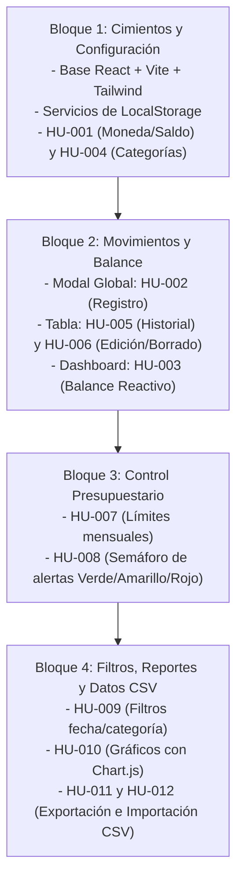

# Fase 5: Historias de Usuario y Criterios de Aceptación — Mi Finanzas IA

---

## 1. Introducción y Metodología

Este documento traduce los requerimientos funcionales, reglas de negocio y especificaciones de diseño aprobados en las fases anteriores a **Historias de Usuario (HU)** ágiles.

Cada historia está redactada con la estructura estándar:
> **Como** [tipo de usuario], **quiero** [funcionalidad], **para** [beneficio esperado].

Los **Criterios de Aceptación** se definen bajo el estándar verificable **Dado que... Cuando... Entonces... (Gherkin/BDD)** para garantizar que cada funcionalidad pueda ser probada objetivamente durante la fase de desarrollo.

---

## 2. Catálogo de Historias de Usuario

### HU-001: Configuración de Moneda y Saldo Inicial
- **Historia:** **Como** usuario personal, **quiero** definir mi símbolo de moneda y registrar un saldo inicial de partida, **para** que los cálculos financieros se adapten a mi país y reflejen con exactitud mi dinero disponible.
- **Trazabilidad:** [RF-002](01-nucleo-aplicacion.md), RN-003, RN-005.
- **Prioridad:** Alta.
- **Criterios de Aceptación:**
  - **Criterio 1.1 (Definición de moneda):**
    - *Dado que* el usuario se encuentra en la pantalla de Configuración,
    - *Cuando* ingresa un símbolo monetario (ej. `$`, `€`, `S/.`, `MXN`) y presiona "Guardar",
    - *Entonces* el sistema actualiza inmediatamente todas las pantallas, mostrando dicho símbolo en todos los importes.
  - **Criterio 1.2 (Saldo inicial patrimonial):**
    - *Dado que* el usuario ingresa un saldo inicial (ej. `500.00`),
    - *Cuando* guarda la configuración,
    - *Entonces* el balance general del Dashboard toma como base inicial dicho valor, sin contabilizarlo como ingreso ordinario del mes en los gráficos ni en el historial de transacciones.
  - **Criterio 1.3 (Persistencia local):**
    - *Dado que* la configuración fue guardada,
    - *Cuando* el usuario recarga o cierra el navegador,
    - *Entonces* el símbolo de moneda y el saldo inicial configurados permanecen intactos.

---

### HU-002: Registro Rápido de Ingresos y Gastos
- **Historia:** **Como** usuario personal, **quiero** registrar mis ingresos y gastos mediante una ventana modal accesible desde cualquier pantalla, **para** anotar mis transacciones en menos de 15 segundos sin interrumpir lo que estoy haciendo.
- **Trazabilidad:** [RF-003](01-nucleo-aplicacion.md), RN-001, RN-002, RN-008.
- **Prioridad:** Alta.
- **Criterios de Aceptación:**
  - **Criterio 2.1 (Apertura universal del modal):**
    - *Dado que* el usuario está en cualquier sección de la aplicación,
    - *Cuando* pulsa el botón `+ Nuevo Movimiento`,
    - *Entonces* se despliega una ventana modal con los campos: Tipo (Ingreso/Gasto), Importe, Fecha (por defecto la actual), Categoría y Descripción opcional.
  - **Criterio 2.2 (Validación de importes positivos):**
    - *Dado que* el usuario intenta registrar un importe menor o igual a cero ($\le 0$) o deja el campo vacío,
    - *Cuando* presiona "Guardar Movimiento",
    - *Entonces* el sistema impide el guardado, resalta el campo en rojo y muestra el mensaje *"El importe debe ser mayor que cero"*.
  - **Criterio 2.3 (Registro exitoso y reactividad):**
    - *Dado que* el usuario completa los datos obligatorios correctamente,
    - *Cuando* presiona "Guardar Movimiento",
    - *Entonces* la ventana modal se cierra, se almacena el movimiento en `LocalStorage`, y el balance general y las tablas se actualizan de inmediato.

---

### HU-003: Consulta del Panel Principal (Dashboard) y Balance General
- **Historia:** **Como** usuario personal, **quiero** consultar un resumen visual consolidado con mi balance, ingresos y gastos del mes, **para** conocer mi situación financiera en segundos.
- **Trazabilidad:** [RF-001](01-nucleo-aplicacion.md), RN-003, RN-004, RN-008.
- **Prioridad:** Alta.
- **Criterios de Aceptación:**
  - **Criterio 3.1 (Cálculo exacto del balance):**
    - *Dado que* existen movimientos registrados y un saldo inicial configurado,
    - *Cuando* el usuario entra al Dashboard,
    - *Entonces* la tarjeta de Balance General muestra exactamente la fórmula: $\text{Saldo Inicial} + \sum \text{Ingresos} - \sum \text{Gastos}$.
  - **Criterio 3.2 (Visualización de balance negativo):**
    - *Dado que* el total de gastos acumulados supera la suma de saldo inicial e ingresos,
    - *Cuando* se calcula el balance general,
    - *Entonces* el importe se muestra con signo negativo y en tipografía/estilo rojo de alerta, sin bloquear la aplicación.
  - **Criterio 3.3 (Últimos movimientos):**
    - *Dado que* el usuario visualiza el Dashboard,
    - *Cuando* existen movimientos registrados,
    - *Entonces* se despliega un bloque con los últimos 5 movimientos ordenados de forma descendente por fecha.

---

### HU-004: Gestión de Categorías Predeterminadas y Personalizadas
- **Historia:** **Como** usuario personal, **quiero** disponer de categorías comunes y poder agregar nuevas o eliminar las que no use, **para** clasificar mis movimientos según mi estilo de vida.
- **Trazabilidad:** [RF-004](01-nucleo-aplicacion.md), RN-006.
- **Prioridad:** Alta.
- **Criterios de Aceptación:**
  - **Criterio 4.1 (Categorías predeterminadas):**
    - *Dado que* el usuario abre la aplicación por primera vez,
    - *Cuando* consulta las categorías disponibles,
    - *Entonces* visualiza un conjunto inicial precargado (Alimentación, Transporte, Vivienda, Salud, Ocio, Salario, Otros).
  - **Criterio 4.2 (Creación de categoría personalizada):**
    - *Dado que* el usuario está en Configuración > Gestión de Categorías,
    - *Cuando* ingresa un nombre no vacío y pulsa "+ Agregar",
    - *Entonces* la nueva categoría queda disponible de inmediato en todos los selectores de la aplicación.
  - **Criterio 4.3 (Eliminación con reasignación a 'Otros'):**
    - *Dado que* una categoría posee movimientos históricos vinculados,
    - *Cuando* el usuario decide eliminarla y confirma la advertencia,
    - *Entonces* la categoría se elimina de la lista y todos sus movimientos pasan automáticamente a pertenecer a la categoría `"Otros"`, sin perder ningún dato.

---

### HU-005: Historial Cronológico de Movimientos
- **Historia:** **Como** usuario personal, **quiero** consultar un listado tabular con todos mis movimientos ordenados cronológicamente, **para** auditar el detalle de mis entradas y salidas de dinero.
- **Trazabilidad:** [RF-005](01-nucleo-aplicacion.md).
- **Prioridad:** Alta.
- **Criterios de Aceptación:**
  - **Criterio 5.1 (Visualización tabular clara):**
    - *Dado que* el usuario accede a la sección Movimientos,
    - *Cuando* se carga la pantalla,
    - *Entonces* visualiza una tabla con columnas: Fecha, Tipo, Categoría, Descripción, Importe y Acciones, con los movimientos más recientes primero.
  - **Criterio 5.2 (Distinción visual de tipos):**
    - *Dado que* la tabla lista ingresos y gastos,
    - *Cuando* se renderizan los importes,
    - *Entonces* los ingresos se muestran en verde con un prefijo `+` y los gastos en rojo con un prefijo `-`.

---

### HU-006: Edición y Eliminación de Movimientos
- **Historia:** **Como** usuario personal, **quiero** modificar o borrar cualquier movimiento registrado por equivocación, **para** mantener mi contabilidad siempre corregida y al día.
- **Trazabilidad:** [RF-006](01-nucleo-aplicacion.md), RN-008.
- **Prioridad:** Alta.
- **Criterios de Aceptación:**
  - **Criterio 6.1 (Edición en modal):**
    - *Dado que* el usuario pulsa el botón "Editar" (lápiz) de una fila en Movimientos,
    - *Cuando* se abre el modal con los datos actuales precargados y el usuario cambia un valor y guarda,
    - *Entonces* el movimiento se actualiza y los balances se recalculan al instante.
  - **Criterio 6.2 (Eliminación con confirmación):**
    - *Dado que* el usuario pulsa el botón "Eliminar" (papelera),
    - *Cuando* el sistema solicita confirmación y el usuario acepta,
    - *Entonces* el registro se borra permanentemente de `LocalStorage` y el balance se reajusta de inmediato.

---

### HU-007: Presupuestos Mensuales por Categoría
- **Historia:** **Como** usuario personal, **quiero** fijar un importe máximo de gasto mensual para categorías específicas, **para** tener control sobre mis gastos discrecionales y no endeudarme.
- **Trazabilidad:** [RF-007](01-nucleo-aplicacion.md), RN-001.
- **Prioridad:** Alta.
- **Criterios de Aceptación:**
  - **Criterio 7.1 (Asignación de presupuesto):**
    - *Dado que* el usuario está en la sección Presupuestos,
    - *Cuando* selecciona una categoría, ingresa un límite ($> 0$) para el mes actual y guarda,
    - *Entonces* se genera una tarjeta de control presupuestario para dicha categoría y mes.
  - **Criterio 7.2 (Cálculo de consumo):**
    - *Dado que* existe un presupuesto fijado para una categoría,
    - *Cuando* se registran gastos en dicha categoría en el mes correspondiente,
    - *Entonces* el sistema suma los gastos y calcula en tiempo real: Importe gastado, Importe restante y Porcentaje consumido.

---

### HU-008: Alertas Visuales con Sistema de Semáforo
- **Historia:** **Como** usuario personal, **quiero** ver barras de progreso con colores de semáforo en mis presupuestos, **para** identificar de un vistazo si estoy gastando de más antes de agotar mi dinero.
- **Trazabilidad:** [RF-008](01-nucleo-aplicacion.md), RN-007.
- **Prioridad:** Alta.
- **Criterios de Aceptación:**
  - **Criterio 8.1 (Semáforo Verde - Consumo Normal):**
    - *Dado que* el gasto acumulado en una categoría es estrictamente menor al 80% de su límite,
    - *Cuando* se renderiza la barra de progreso,
    - *Entonces* la barra y la etiqueta de estado se muestran en color verde.
  - **Criterio 8.2 (Semáforo Amarillo - Alerta Preventiva):**
    - *Dado que* el gasto acumulado alcanza o supera el 80% y es menor al 100%,
    - *Cuando* se renderiza la barra de progreso,
    - *Entonces* se muestra en color amarillo junto a la advertencia visual *"Cerca del límite"*.
  - **Criterio 8.3 (Semáforo Rojo - Presupuesto Excedido):**
    - *Dado que* el gasto acumulado alcanza o supera el 100% del límite fijado,
    - *Cuando* se renderiza la barra,
    - *Entonces* se muestra en color rojo con la advertencia *"Límite alcanzado o superado"* y se indica el monto excedido.

---

### HU-009: Filtros de Búsqueda por Fechas y Categorías
- **Historia:** **Como** usuario personal, **quiero** filtrar mis movimientos por rango de fechas y por categoría, **para** analizar gastos específicos de un período o rubro determinado.
- **Trazabilidad:** [RF-009](01-nucleo-aplicacion.md).
- **Prioridad:** Media.
- **Criterios de Aceptación:**
  - **Criterio 9.1 (Filtro por períodos predefinidos y personalizados):**
    - *Dado que* el usuario se encuentra en la pantalla de Movimientos,
    - *Cuando* selecciona "Este Mes", "Mes Anterior" o un rango de fechas libre,
    - *Entonces* la tabla muestra únicamente los movimientos comprendidos en dicho rango y recalcula el total filtrado.
  - **Criterio 9.2 (Filtro por categoría):**
    - *Dado que* el usuario elige una categoría del filtro (ej. "Alimentación"),
    - *Cuando* se aplica el filtro,
    - *Entonces* solo se listan los movimientos asociados a dicha categoría.

---

### HU-010: Reportes y Gráficos Financieros Interactivos
- **Historia:** **Como** usuario personal, **quiero** ver gráficos de dona y barras de mis finanzas, **para** entender visualmente en qué rubros gasto más y comparar mis ingresos frente a mis gastos.
- **Trazabilidad:** [RF-010](01-nucleo-aplicacion.md).
- **Prioridad:** Media.
- **Criterios de Aceptación:**
  - **Criterio 10.1 (Gráfico de distribución por categoría):**
    - *Dado que* el usuario navega a la sección Reportes,
    - *Cuando* existen gastos en el período seleccionado,
    - *Entonces* se renderiza un gráfico de dona (Chart.js) que muestra el porcentaje de gasto que representa cada categoría sobre el total.
  - **Criterio 10.2 (Gráfico comparativo de ingresos vs. gastos):**
    - *Dado que* existen movimientos en el mes,
    - *Cuando* se visualiza el reporte,
    - *Entonces* se muestra un gráfico de barras comparando el total de ingresos frente al total de gastos para evaluar la capacidad de ahorro.

---

### HU-011: Exportación de Movimientos a CSV
- **Historia:** **Como** usuario personal, **quiero** descargar mis movimientos en un archivo CSV estructurado, **para** respaldar mi información en mi computadora o analizarla en hojas de cálculo.
- **Trazabilidad:** [RF-011](01-nucleo-aplicacion.md), RN-009.
- **Prioridad:** Media.
- **Criterios de Aceptación:**
  - **Criterio 11.1 (Descarga del archivo):**
    - *Dado que* el usuario está en la sección Movimientos y pulsa "Descargar / Exportar CSV",
    - *Cuando* se procesa la descarga,
    - *Entonces* el navegador descarga un archivo `.csv` con la cabecera: `Fecha,Tipo,Categoría,Descripción,Importe`.
  - **Criterio 11.2 (Fidelidad de datos):**
    - *Dado que* se exportan movimientos,
    - *Cuando* se abre el archivo CSV descargado,
    - *Entonces* el 100% de las fechas, importes numéricos y conceptos coinciden exactamente con los registrados en la aplicación.

---

### HU-012: Importación de Movimientos desde CSV Estándar
- **Historia:** **Como** usuario personal, **quiero** subir un archivo CSV que siga la plantilla oficial, **para** cargar masivamente transacciones previas o restaurar un respaldo anterior.
- **Trazabilidad:** [RF-012](01-nucleo-aplicacion.md), RN-009.
- **Prioridad:** Media.
- **Criterios de Aceptación:**
  - **Criterio 12.1 (Importación válida y notificación):**
    - *Dado que* el usuario pulsa "Subir / Importar CSV" y selecciona un archivo válido con la plantilla oficial,
    - *Cuando* el sistema valida las columnas y tipos de datos,
    - *Entonces* se agregan los nuevos movimientos a `LocalStorage` y se muestra un mensaje informativo con el total de registros importados exitosamente.
  - **Criterio 12.2 (Rechazo de archivo incompatible):**
    - *Dado que* el usuario sube un archivo con columnas incorrectas o datos corruptos,
    - *Cuando* el parser de validación detecta la anomalía,
    - *Entonces* se detiene la importación, no se alteran los datos existentes y se muestra el mensaje: *"El archivo no cumple con la estructura requerida. Utiliza la plantilla oficial"*.

---

## 3. Matriz de Trazabilidad de Requerimientos

| Requerimiento Funcional (Fase 1) | Historia de Usuario (Fase 5) | Prioridad | Pantalla Principal (Fase 2) |
| :--- | :--- | :--- | :--- |
| **RF-001 (Dashboard)** | **HU-003** | Alta | Dashboard |
| **RF-002 (Moneda y Saldo Inicial)** | **HU-001** | Alta | Configuración |
| **RF-003 (Registro de Movimientos)** | **HU-002** | Alta | Modal Global (+ Nuevo Movimiento) |
| **RF-004 (Gestión de Categorías)** | **HU-004** | Alta | Configuración |
| **RF-005 (Historial de Movimientos)** | **HU-005** | Alta | Movimientos |
| **RF-006 (Edición y Eliminación)** | **HU-006** | Alta | Movimientos |
| **RF-007 (Presupuestos Mensuales)** | **HU-007** | Alta | Presupuestos |
| **RF-008 (Alertas Semáforo)** | **HU-008** | Alta | Presupuestos y Dashboard |
| **RF-009 (Filtros de Búsqueda)** | **HU-009** | Media | Movimientos |
| **RF-010 (Gráficos Interactivos)** | **HU-010** | Media | Reportes |
| **RF-011 (Exportación CSV)** | **HU-011** | Media | Movimientos |
| **RF-012 (Importación CSV)** | **HU-012** | Media | Movimientos |

---

## 4. Priorización y Orden Recomendado de Implementación

Para asegurar un desarrollo incremental sin bloqueos por dependencias técnicas, se propone estructurar la construcción en **4 fases lógicas de desarrollo**:

1. **Bloque 1 — Cimientos, Almacenamiento y Categorías (Semana 1):**
   - Configuración inicial del proyecto con Vite, React y Tailwind CSS.
   - Creación del servicio de almacenamiento en `LocalStorage`.
   - Implementación de **HU-001** (Moneda y Saldo) y **HU-004** (Categorías predeterminadas y personalizadas).
2. **Bloque 2 — Transacciones y Dashboard Central (Semana 2):**
   - Implementación de **HU-002** (Modal de registro rápido).
   - Implementación de **HU-005** y **HU-006** (Historial en tabla, edición y borrado).
   - Implementación de **HU-003** (Dashboard con cálculo reactivo de balance).
3. **Bloque 3 — Presupuestos y Semáforo de Control (Semana 3):**
   - Implementación de **HU-007** (Asignación de presupuestos mensuales).
   - Implementación de **HU-008** (Cálculo de consumo y alertas semáforo verde, amarillo y rojo).
4. **Bloque 4 — Filtros, Visualización y Respaldo CSV (Semana 4):**
   - Implementación de **HU-009** (Filtros en el historial).
   - Implementación de **HU-010** (Gráficos interactivos de Chart.js en Reportes).
   - Implementación de **HU-011** y **HU-012** (Exportación e Importación CSV con validación).

---

## 5. Estado de la Fase 5
- **Estado:** Aprobada formalmente.
