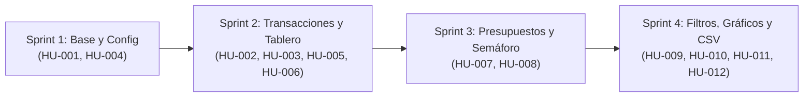

# Documento Maestro de Requerimientos y Especificación — Mi Finanzas IA

---

## Control del Documento
- **Proyecto:** Mi Finanzas IA
- **Tipo de Aplicación:** Aplicación Web de Gestión de Finanzas Personales (Local-First)
- **Versión del Documento:** 1.0 (Consolidado de Fases 1 a 5)
- **Estado:** Aprobado Formalmente (Fase de Análisis y Planificación Completada)

---

## 1. Objetivos y Alcance del MVP

### 1.1. Objetivo General
Proporcionar a personas particulares una herramienta web moderna, intuitiva y accesible que les permita registrar, entender y optimizar sus finanzas personales sin requerir conocimientos técnicos ni contables.

### 1.2. Alcance del MVP (Producto Mínimo Viable)
- **Dentro del Alcance:**
  - Configuración de moneda personalizada y saldo inicial patrimonial.
  - Panel principal (Dashboard) con balance general reactivo y resumen financiero.
  - Registro de ingresos y gastos mediante modal global (< 15 segundos).
  - Historial tabular con filtros por fecha y categoría.
  - Edición y eliminación de transacciones con recálculo automático.
  - Gestión de categorías (predeterminadas y personalizadas con reasignación segura a "Otros").
  - Presupuestos mensuales por categoría con semáforo visual de tres niveles (Verde <80%, Amarillo 80-99.9%, Rojo $\ge$100%).
  - Reportes gráficos interactivos (gráfico circular de gastos y barras de ingresos vs. gastos).
  - Respaldo e importación mediante plantilla oficial CSV de 5 columnas.
  - Almacenamiento 100% local en el navegador del usuario (`LocalStorage`) a costo $0.
- **Fuera del Alcance del MVP (Fases Posteriores):**
  - Autenticación con usuario y contraseña (es monousuario local).
  - Conexión bancaria automática o pasarelas de pago.
  - Sincronización en la nube multi-dispositivo en tiempo real.
  - Módulos de análisis asistido por Inteligencia Artificial (se integrará en una fase posterior sin alterar el núcleo).

---

## 2. Usuarios y Roles
- **Usuario Personal (Único):** Persona individual que accede a la aplicación desde su navegador. Dispone de acceso total a la configuración, registros, reportes y exportación en su entorno local.

---

## 3. Requerimientos Funcionales y Reglas de Negocio

### 3.1. Requerimientos Funcionales (RF)
- **RF-001:** Panel de Control Principal (Dashboard) con balance, ingresos y gastos actualizados al instante.
- **RF-002:** Configuración de símbolo de moneda y registro de saldo inicial único.
- **RF-003:** Registro de movimientos (tipo, importe, fecha, categoría y descripción opcional).
- **RF-004:** Gestión de categorías (predeterminadas y personalizadas).
- **RF-005:** Historial y listado cronológico de movimientos.
- **RF-006:** Edición y eliminación de movimientos existentes.
- **RF-007:** Presupuestos mensuales fijados por categoría.
- **RF-008:** Alertas visuales de presupuesto con código de semáforo.
- **RF-009:** Filtros de consulta por rango de fechas y categorías.
- **RF-010:** Gráficos financieros interactivos (distribución y comparativa mensual).
- **RF-011:** Exportación completa de movimientos a archivo CSV estándar.
- **RF-012:** Importación masiva desde archivo CSV validado con plantilla oficial.

### 3.2. Reglas de Negocio (RN)
- **RN-001 (Importes positivos):** Todo importe debe ser mayor que cero ($> 0$).
- **RN-002 (Integridad de datos):** Obligatorios los campos Tipo, Importe, Categoría y Fecha.
- **RN-003 (Fórmula del Balance General):** $\text{Balance} = \text{Saldo Inicial} + \sum \text{Ingresos} - \sum \text{Gastos}$.
- **RN-004 (Balance negativo en rojo):** Si el balance es menor a cero ($< 0$), se muestra en color rojo con signo negativo.
- **RN-005 (Tratamiento del saldo inicial):** Se contabiliza una única vez en el balance general, sin duplicarse como ingreso mensual ordinario.
- **RN-006 (Reasignación de categorías):** Al borrar una categoría con movimientos, estos pasan automáticamente a `"Otros"`.
- **RN-007 (Umbrales de semáforo):** Verde ($< 80\%$), Amarillo ($80\% - 99.9\%$), Rojo ($\ge 100\%$).
- **RN-008 (Reactividad total):** Toda modificación recalcula inmediatamente balances, gráficos y alertas.
- **RN-009 (Estructura CSV fija):** Estricta coincidencia con: `Fecha,Tipo,Categoría,Descripción,Importe`.

---

## 4. Arquitectura de Información, Pantallas y Flujos

### 4.1. Navegación Principal
- **Barra Lateral Izquierda (Sidebar):**
  - Botón prominente: `+ Nuevo Movimiento` (abre modal global).
  - Secciones: **Dashboard**, **Movimientos**, **Presupuestos**, **Reportes**, **Configuración**.
- **Botones de datos:** Ubicados en **Movimientos** (Importar y Exportar CSV) y en **Configuración** (Descargar Plantilla CSV).

### 4.2. Flujos Clave de Interacción
1. **Configuración inicial:** Definición del símbolo monetario y saldo inicial de partida.
2. **Registro sin fricción:** Modal rápido desde cualquier vista (< 15 segundos).
3. **Control visual:** Monitoreo del semáforo presupuestario en tiempo real.
4. **Prevención de pérdidas:** Advertencia ante borrado de categorías con transacciones asociadas y rechazo seguro de CSV incompatibles.

---

## 5. Requerimientos No Funcionales (Calidad y Rendimiento)
- **Rendimiento:** Carga inicial en $< 2.0$ segundos; respuesta a interacciones y guardado en $< 100$ ms; actualización de gráficos en $< 300$ ms.
- **Seguridad y Privacidad (*Local-First*):** 100% de la información financiera en el navegador (`LocalStorage`). Cero transferencia de datos personales a servidores externos. Sanitización contra inyección de código (Anti-XSS).
- **Fiabilidad:** Persistencia inmediata síncrona. Manejo de errores con pantallas protectoras (*Error Boundary*).
- **Disponibilidad:** 100% operativa sin conexión a internet (Offline).
- **Compatibilidad:** Responsiva en PC, tabletas y teléfonos móviles; compatible con Chrome, Firefox, Edge y Safari.
- **Costo Operativo:** **$0.00 USD** utilizando licencias de código abierto y plan gratuito permanente en Vercel.

---

## 6. Modelo de Datos y Stack Técnico

### 6.1. Entidades de Datos (JSON en LocalStorage)
- **`Movimiento`:** `{ id, tipo, importe, fecha, categoriaId, descripcion, creadoEn }`
- **`Categoria`:** `{ id, nombre, esPredeterminada }`
- **`Presupuesto`:** `{ id, categoriaId, mes, limite }`
- **`Configuracion`:** `{ moneda, saldoInicial }`

### 6.2. Stack Tecnológico
- **Frontend y Framework:** React 18+ con Vite.
- **Diseño Visual:** Tailwind CSS.
- **Iconografía:** Lucide Icons.
- **Gráficos:** Chart.js.
- **Procesamiento de Archivos:** PapaParse (CSV).
- **Alojamiento y Despliegue:** Vercel (HTTPS automático).

---

## 7. Catálogo Consolidado de Historias de Usuario

| ID | Historia de Usuario | Prioridad | Criterios Clave de Aceptación |
| :--- | :--- | :--- | :--- |
| **HU-001** | Configuración de moneda y saldo inicial patrimonial | Alta | Configuración persistente; balance inicial no duplicado como ingreso. |
| **HU-002** | Registro ágil de ingresos y gastos mediante modal | Alta | Modal universal, validación de importes $>0$, recálculo instantáneo. |
| **HU-003** | Consulta de Dashboard y balance reactivo | Alta | Balance exacto, color rojo si es negativo, últimos 5 movimientos. |
| **HU-004** | Gestión de categorías con reasignación a 'Otros' | Alta | Categorías estándar precargadas; reasignación al borrar. |
| **HU-005** | Historial cronológico tabular de transacciones | Alta | Tabla clara con importes verdes (+) y rojos (-). |
| **HU-006** | Edición y eliminación de movimientos | Alta | Edición en modal y eliminación con diálogo de confirmación. |
| **HU-007** | Creación y seguimiento de presupuestos mensuales | Alta | Límite mensual por categoría con cálculo de consumo en tiempo real. |
| **HU-008** | Alertas visuales con código semáforo | Alta | Verde (<80%), Amarillo (80%-99.9%), Rojo ($\ge$100%). |
| **HU-009** | Filtros de búsqueda por fecha y categoría | Media | Filtrado en tabla por períodos preestablecidos, rango libre y rubro. |
| **HU-010** | Reportes con gráficos interactivos (dona y barras) | Media | Distribución de gastos por categoría y comparativa ingresos vs gastos. |
| **HU-011** | Exportación de movimientos a CSV estándar | Media | Generación de archivo con formato estándar descargable en un clic. |
| **HU-012** | Importación masiva desde CSV con validación | Media | Validación estricta de estructura antes de añadir a LocalStorage. |

---

## 8. Prioridades y Orden Lógico de Desarrollo

1. **Sprint 1 (Cimientos y Ajustes):** Configuración de Vite/React/Tailwind, creación de la capa de almacenamiento en LocalStorage, y desarrollo de **HU-001** (Moneda/Saldo) y **HU-004** (Categorías).
2. **Sprint 2 (Operaciones y Dashboard):** Creación del Sidebar y del Modal global de registro (**HU-002**), tabla de historial (**HU-005**), edición/borrado (**HU-006**) y Dashboard con balance reactivo (**HU-003**).
3. **Sprint 3 (Control Presupuestario):** Asignación de límites (**HU-007**) y barras de progreso con semáforo verde/amarillo/rojo (**HU-008**).
4. **Sprint 4 (Análisis y Portabilidad):** Filtros avanzados (**HU-009**), gráficos de Chart.js (**HU-010**) y módulos de exportación e importación CSV con PapaParse (**HU-011**, **HU-012**).

---

## 9. Referencias a la Documentación de Fases
- **Fase 1 (Núcleo de la Aplicación):** [`docs/01-nucleo-aplicacion.md`](01-nucleo-aplicacion.md)
- **Fase 2 (Experiencia de Usuario):** [`docs/02-experiencia-usuario.md`](02-experiencia-usuario.md)
- **Fase 3 (Requisitos de Calidad):** [`docs/03-requisitos-calidad.md`](03-requisitos-calidad.md)
- **Fase 4 (Datos y Tecnología):** [`docs/04-datos-tecnologia.md`](04-datos-tecnologia.md)
- **Fase 5 (Historias de Usuario):** [`docs/05-historias-usuario.md`](05-historias-usuario.md)

---

## 10. Aprobación y Cierre de la Etapa de Análisis
- **Estado:** Documento Maestro y Fases 1 a 5 aprobados formalmente. Etapa de análisis y planificación finalizada con éxito. Listos para iniciar el desarrollo de la aplicación.
